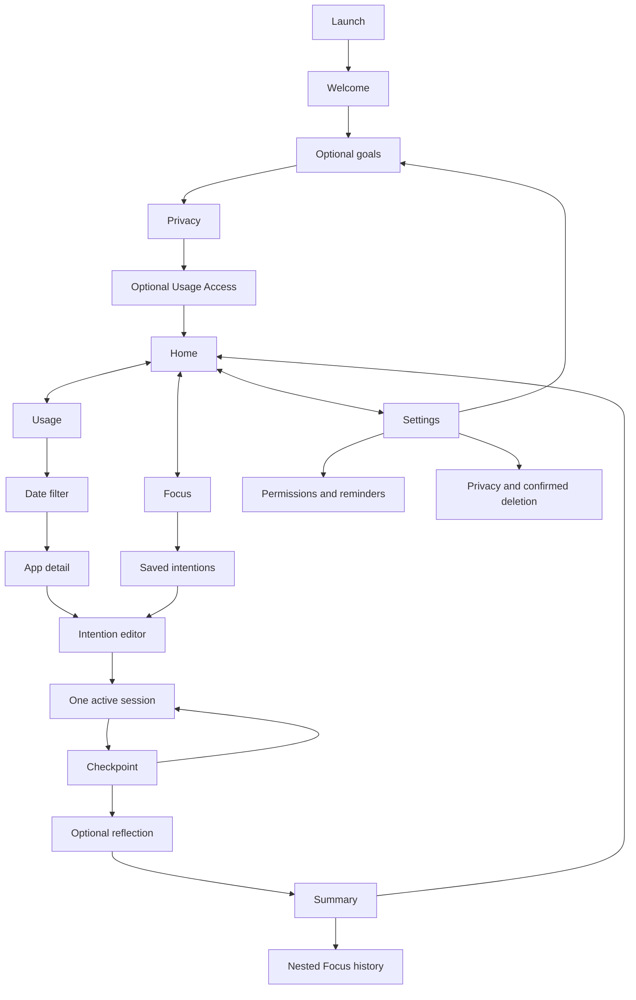

# Phase 0 repository and reference audit

Audit date: 2026-11-17. Scope: FR-02 through FR-05, FR-07, FR-08, FR-10 through FR-14 feasibility only. Existing requirements and references remain authoritative and unchanged.

## Workspace and environment

Read README.md, AGENTS.md, agent/CODEX_MASTER_PROMPT.md and all eight supplied product/research/design/engineering/QA documents, android/README.md and extracted wireframe text before implementation. Initially no Kotlin, Gradle project, wrapper, or Git repository existed; only documentation, screenshots, a PDF and IDE metadata were present. Initialize local Git history to preserve this baseline, then create the Android Studio root under android/.

Observed Windows tools: JDK 17.0.20, Node/npx, Python 3.12, Android Studio installation, Android SDK platforms including 35, Build Tools 35.0.0, cached AGP 8.9.1, Kotlin 2.0.21 and Gradle 8.11.1. Choose that compatible stable build chain and compile/target 35 for this experiment, not a release-readiness claim. ADB enumeration returned no devices. Actual Fold5 model/OS/build remains unknown.

## Reference access and screen inventory

Attempted https://focusloopjosh.my.canva.site/ through web access; tool returned inaccessible/internal error. In-app browser execution tool was not available. No live screen transitions or complete site traversal are claimed. Inspected every supplied PNG visually, and all 13 PDF pages via rendered contact sheets, alongside extracted text. Reference files were not modified.

| Reference | Confirmed visual content | Requirements / gaps |
|---|---|---|
| 1.png | Compact Home, Usage, Focus, Settings and unfolded Home; example badges; quick-start chips, app rows, four tabs | FR-03/04/06/10/12/13; only unfolded Home supplied |
| 2.png | App detail, date dropdown, illustrative total/average/session count, daily chart, coverage note, create intention | FR-04/05/06/10; device-only label does not establish temporal coverage; definition/source of Sessions unresolved |
| 3.png | Welcome and optional multi-select goals, Continue/Skip | FR-01/14; combined welcome/goals differs from separate screens in flow contract |
| 4.png | Privacy/optional Usage Access, unavailable variant, Enable/Not now | FR-02/03/10/14; accurate manual-mode fallback |
| 5.png | Intention editor, required title/duration, optional app/reminder/template, Cancel/Start | FR-06/07/11; no live editor behavior verified |
| 6.png | Active timer, Pause/Extend/Finish; voluntary checkpoint Finish/Extend/Revise/Dismiss | FR-07/08/11/14; elapsed versus active/remaining labels need explicit semantics |
| 7.png | Optional reflection choices plus summary, unanswered outcome | FR-08/09/10; Home/Focus history footer differs from four primary tabs, treat history as nested destination |
| 9.png, 10.png | Entirely white, confirmed visually and RGB extrema all 255 | No usable screen content; 8.png not supplied |
| FocusLoop Design System.png | Palette, type, spacing, components, adaptive rules | FR-10/12/14; exact font family not supplied |
| Wireframe PDF, 13 pages | Foundation; navigation; welcome/goals; privacy; Home; Usage; detail; library/editor; active/checkpoint; reflection/summary; Settings; fold; handoff | Earlier structural reference; all numbers explicitly illustrative |

## Observed tokens and native component mapping

Design-system colors: primary #0F7C88, ink #16343A, muted #5E7074, surface #FFFFFF, canvas #F7FAFB. Type sizes: body 12/14/16, section 20, screen 30; 8 dp rhythm, minimum target 48 dp. System font until actual font assets are supplied. Use Material 3 cards, buttons, fields and chips with native insets, scalable text, and content descriptions. Thin borders and medium rounded cards; no fixed phone frame or screenshot rasterization. Native touch targets and readable contrast take precedence. Compact scrollable single column, expanded paired panels based on current window constraints; final navigation rail/bar reserved for later production UI.

Reusable inventory: app bar/back, metric/provenance cards, permission/coverage states, application rows, date chips, filled/outlined/text actions, optional selection chips, editor sheet, timer controls, checkpoint sheet, reflection choices, history/detail rows, deletion confirmation. Only diagnostic cards/actions/filters are needed in phase 1.

## Navigation graph (contract, not observed working links)

Back must preserve filters, permission/goals can be skipped, active session restoration precedes creation, and reflection never determines whether a session ended. Static arrows/buttons suggest transitions; only the product screen-flow document defines behavior.

## Evidence and requirement crosswalk

| Experiment decision | IDs | Basis | Proof / limitations |
|---|---|---|---|
| Optional AppOps-gated usage; no cache presented as current after revoke | FR-03/14 | Privacy/autonomy requirement; R01/R03/R04 principles, not validated app effectiveness | Mapping tests plus pending grant/revoke device checks |
| Today/yesterday/7-day per-package diagnostic with requested and returned bucket bounds | FR-04/05/10 | C01 preference and platform API, conditional MVP | Unit boundary/empty tests; device comparison pending; 14/28/custom deferred |
| One persistent session, pause/resume, immutable plan, append extensions | FR-07/08/10 | Engineering integrity; C02/R02/R03 hypothesis | Domain tests and SQLite instrumentation test; real process death pending |
| Explicit uncertain recovery after reboot, monotonic time within boot | FR-07/10 | Engineering requirement | Deterministic clock tests; real reboot pending |
| Opt-in inexact reminder probe, never required for sessions | FR-11/14 | Android platform and autonomy | Manifest/build checks; delivery/idle/device permissions pending |
| Native adaptive diagnostic panels, no production navigation | FR-12 | Design assets and engineering requirement | Build/lint; actual resize/font/TalkBack pending |
| Private app-only session record, usage queried in memory, backup excluded | FR-02/10/13 | Mandatory local-first/minimized permissions | Source/manifest review; deletion only for experiment record, not full production history |

Evidence register was read as provided. Original research full texts were not freshly audited; no quotations, effect sizes, participant findings or effectiveness claims are added. C01-C03 remain single-user competitor observations; R06 bibliographic uncertainty remains unresolved. Research citations are not evidence that this implementation works.

## State matrix and open risks

- Usage: checking/loading, granted, denied/not granted, revoked (previous grant recorded), locked/user unavailable, service unavailable/error, empty records, records with unknown coverage. Missing data is never numeric zero. API buckets may extend outside requested range; do not clip duration proportionally or promise exact totals. Package labels may be unavailable; retain package identifier. Foreground sums are not device interactive time, especially multi-window.
- Session: absent, running, paused, finished/cancelled, restored, uncertain after reboot/boot-ID unavailable, storage error/corruption. Never silently discard corruption or reconstruct a reboot gap from wall time. Timer reaching target does not forcibly finish or claim task success.
- Reminder: permission denied, app/channel disabled, scheduled, delivered late, cancelled, lost on reboot/force-stop. No exact alarm or background reliability promises.
- Design gaps: no expanded Usage/Focus/Settings, large-font states, error/revoked/loading variants, custom-range reliability, actual icons/font/license assets, or verified live interactions. Prototype text mentioning Canva Sheet storage must not be carried into Android.
- Full Room history, outcomes, onboarding, templates, charts, 14/28/custom analytics, app details and production UI belong to later gated phases. Phase 1 stores one experimental session only in SQLite; it is not a production history schema.

## Limited implementation plan and stop condition

1. Preserve starter in local Git, initialize android/ with reproducible wrapper and pinned compatible versions.
2. Add isolated pure Kotlin session/usage rules; Android usage, SQLite and reminder adapters; ViewModel/Flow and a clearly labelled Compose diagnostic surface.
3. Test single-session transitions, persistence boundary, monotonic timing, reboot/clock anomalies, extension integrity, range boundaries and unavailable-versus-zero. Build/lint/JVM tests; compile device tests even if no device is present.
4. Record actual commands/results, changed-file/requirement mapping, platform sources and precise Fold5 manual checks in the phase 1 report.
5. Stop after feasibility findings. No phase 2+ implementation until explicit authorization after review.
